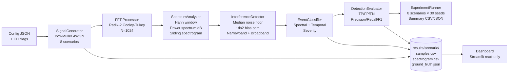

# WaveBreak

> **This is a synthetic signal-processing simulator, not a real RF detection system.**
> It generates artificial I/Q samples in software, processes them, and measures detector performance
> against known ground-truth labels. No radio hardware, no real signals, no real-world guarantees.

---

## What It Is

WaveBreak is a C++17 command-line tool that simulates baseband interference, detects it with a
classical spectral detector, and evaluates detection quality with standard retrieval metrics. 

---

## Architecture



---

## Pipeline Details

### Signal generation
- Complex baseband I/Q samples at **fs = 1 MHz**, **262 144 samples** (~0.26 s) per run, seed 42.
- AWGN via **hand-written Box-Muller** (not `std::normal_distribution`), seeded with `mt19937_64`.
- SNR definition: `SNR_dB = 10 log10(A² / σ²)`, σ² = total complex noise power (σ²/2 per I and Q).
- 8 scenarios with ground-truth written from generator parameters only, never from the detector:

| Scenario | Description |
|----------|-------------|
| `clean` | 60 dB SNR desired tone only, no interference |
| `low_noise` | 30 dB SNR, no interference |
| `high_noise` | 0 dB SNR, no interference |
| `narrowband` | 20 dB SNR + tone at +250 kHz, amplitude 0.3 |
| `broadband` | 20 dB SNR + 150 kHz band-limited noise centred at +275 kHz |
| `burst` | Narrowband tone at +250 kHz, 3 bursts of 20 ms, period 80 ms |
| `multi` | Two narrowband tones at distinct frequencies |
| `drift` | Tone with a linear frequency ramp |

### FFT / windowing
- **Radix-2 Cooley-Tukey FFT**, size N = 1024 (power-of-2 enforced; non-powers return an error).
- **Periodic Hann window** `w[n] = 0.5 − 0.5 cos(2πn/N)`, normalised by Σw² so power is unbiased.
- **Frequency resolution = fs / N = 1 000 000 / 1024 ≈ 976.6 Hz/bin**.
- FFT-shifted frequency axis: bin k → frequency `(k − N/2) × fs/N`.
- Sliding spectrogram: hop = 512 samples (50 % overlap), dB floor applied, columns decimated to ≤ 512.

### Interference detection (per window)
1. **Guard band**: exclude the desired tone bin ± 5 bins from noise-floor estimation and narrowband scan.
2. **Noise floor**: `median(remaining bin powers) × (1/ln 2)` — the factor 1/ln 2 ≈ 1.4427 corrects
   the ~1.6 dB downward bias of the median under exponential noise.  
   ⚠️ **Known limitation:** the median floor is unreliable if interference covers > 50 % of the band.
3. **Narrowband**: contiguous run of ≤ 5 bins all exceeding `floor + threshold_db` (default **20 dB**,
   configurable). Peak frequency estimated by **parabolic interpolation**. Each event carries peak
   power, margin, and a text reason.
4. **Broadband**: divide the spectrum into 16 equal sub-bands (~62.5 kHz each). Compute **trimmed mean**
   per sub-band (top 5 bins removed to avoid narrowband contamination). Flag sub-bands where
   `trimmed_mean > floor + 3 dB`. Report a contiguous flagged span ≥ 50 kHz as broadband.
5. **Merge**: consecutive flagged windows are merged into one event (merge gap ≤ 2 windows, minimum 2
   windows).

### Event classification (deterministic)
- **Spectral category**: broadband if bandwidth ≥ 50 kHz, else narrowband, else uncertain.
- **Temporal flag**: continuous if the event covers ≥ 90 % of the recording, else burst.
- **Severity** (narrowband: margin < 18 dB → low, < 25 → medium, ≥ 25 → high; broadband: < 6/12/≥12).
- Normal = no events detected.

### Evaluation
- One-to-one matching: detected event matches ground truth if time ranges overlap (± 1 window tolerance)
  and frequency within ± 2 kHz (narrowband) or bands overlap (broadband).
- Metrics: TP, FP, FN, precision, recall, F1 (null when 0/0), false alarms per minute, mean detection
  delay, window-level confusion matrix, event-level type confusion matrix.

### Detection threshold note
The default `threshold_db = 20 dB` was tuned to this simulator's conditions: the desired tone at
+100 kHz (amplitude 1.0, 60 dB SNR) produces Hann-window sidelobes of up to ~19 dB above the noise
floor. Using 13 dB (the original spec default) caused false alarms in every clean-scenario run. 20 dB
was the minimum value that yielded zero false alarms across 90 runs (3 scenarios × 30 seeds). **This
threshold is not validated on real hardware or real signals.**

---

## Folder Tree

```
WaveBreak/
├── CMakeLists.txt
├── README.md
├── PROGRESS.md
├── .gitignore
├── config/
│   └── default_config.json
├── include/wavebreak/
│   ├── common.hpp
│   ├── fft_processor.hpp
│   ├── spectrum_analyzer.hpp
│   ├── signal_generator.hpp
│   ├── config_loader.hpp
│   ├── io_writers.hpp
│   ├── interference_detector.hpp
│   ├── event_classifier.hpp
│   ├── detection_evaluator.hpp
│   └── cli.hpp
├── src/
│   ├── fft_processor.cpp
│   ├── spectrum_analyzer.cpp
│   ├── signal_generator.cpp
│   ├── config_loader.cpp
│   ├── io_writers.cpp
│   ├── interference_detector.cpp
│   ├── event_classifier.cpp
│   ├── detection_evaluator.cpp
│   ├── experiment_runner.cpp
│   ├── cli.cpp
│   └── main.cpp
├── tests/
│   ├── test_harness.hpp
│   ├── main_tests.cpp
│   ├── test_fft.cpp
│   ├── test_spectrum_analyzer.cpp
│   ├── test_signal_generator.cpp
│   ├── test_config_loader.cpp
│   ├── test_cli_and_io.cpp
│   └── test_detector_and_evaluator.cpp
├── scripts/
│   ├── run_demo.ps1
│   └── run_experiments.ps1
├── dashboard/
│   ├── app.py
│   └── requirements.txt
├── docs/
│   └── interview_guide.md
└── results/              ← generated at runtime, not committed
    ├── summary.csv
    ├── summary.json
    └── <scenario>/
        ├── samples.csv
        ├── samples_meta.json
        ├── ground_truth.json
        ├── spectrogram.csv
        ├── events.json
        └── metrics.json
```

---

## Quick Start (PowerShell)

### 1 — Check tools

```powershell
g++ --version
cmake --version
git --version
python --version  # only needed for the dashboard
```

### 2 — Configure and build (Release)

```powershell
cmake -B build -G Ninja -DCMAKE_BUILD_TYPE=Release
cmake --build build
```

### 3 — Run all tests

```powershell
ctest --test-dir build --output-on-failure
```

Expected: **5212 assertions, 0 failures**.

### 4 — Run demo (narrowband simulate + analyze + print)

```powershell
.\build\wavebreak.exe demo
```

Or via script (auto-builds if needed):

```powershell
.\scripts\run_demo.ps1
```

### 5 — Run experiments (8 scenarios × 30 seeds)

```powershell
.\build\wavebreak.exe evaluate
```

Or via script:

```powershell
.\scripts\run_experiments.ps1
```

### 6 — Benchmark

```powershell
.\build\wavebreak.exe benchmark
```

### 7 — Simulate a single scenario

```powershell
.\build\wavebreak.exe simulate --scenario narrowband
.\build\wavebreak.exe simulate --scenario broadband --seed 99
```

### 8 — Analyze saved samples

```powershell
.\build\wavebreak.exe analyze --input results/narrowband/samples.csv --meta results/narrowband/samples_meta.json
```

### 9 — Dashboard (requires Python + Streamlit)

```powershell
pip install -r dashboard/requirements.txt
streamlit run dashboard/app.py
```

---

## Actual Test Results

Compiler: **GCC 16.2.0** · Build type: **Release** · Generator: **Ninja**

```
Test suite: 5212 assertions, 0 failures, 0 errors
CTest: 1/1 Test #1: wavebreak_tests ..... Passed
```

### Experiment Summary (8 scenarios × 30 seeds)

| Scenario | Runs | TP | FP | FN | F1 | FA/min |
|------------|------|----|----|----|-------|--------|
| clean | 30 | 0 | 0 | 0 | null | 0.00 |
| low_noise | 30 | 0 | 0 | 0 | null | 0.00 |
| high_noise | 30 | 0 | 0 | 0 | null | 0.00 |
| narrowband | 30 | 30 | 0 | 0 | 1.000 | 0.00 |
| broadband | 30 | 30 | 0 | 0 | 1.000 | 0.00 |
| burst | 30 | 90 | 0 | 0 | 1.000 | 0.00 |
| multi | 30 | 60 | 0 | 0 | 1.000 | 0.00 |
| drift | 30 | 30 | 0 | 0 | 1.000 | 0.00 |

*null F1 means no ground-truth events exist (clean/low_noise/high_noise are correct — no interference).*

### Benchmark (GCC 16.2.0, Release, 3 warm-ups, 20 iterations)

| Samples | Duration (s) | Windows | Median (ms) | Throughput |
|---------|-------------|---------|-------------|------------|
| 2^16 = 65 536 | 0.066 | 127 | 20.39 ms | 3.21 MS/s |
| 2^18 = 262 144 | 0.262 | 511 | 85.62 ms | 3.06 MS/s |
| 2^20 = 1 048 576 | 1.049 | 2047 | 1382.04 ms | 0.76 MS/s |

---

## CLI Reference

```
wavebreak <command> [options]

Commands:
  simulate    Generate and save signal scenario
  analyze     Detect interference in saved samples
  evaluate    Run all 8 scenarios × 30 seeds, write summary.csv/json
  benchmark   Measure throughput for 2^16, 2^18, 2^20 samples
  demo        simulate narrowband + analyze + print events and metrics

Options (simulate):
  --scenario <name>   clean|low_noise|high_noise|narrowband|broadband|burst|multi|drift
  --config <file>     JSON config override
  --seed <n>          RNG seed (default: 42)
  --out <dir>         Output directory (default: results/<scenario>)

Options (analyze):
  --input <file>      samples.csv
  --meta <file>       samples_meta.json
  --config <file>     JSON config override
  --out <dir>         Output directory

Exit codes:
  0  success
  1  runtime error
  2  usage / config error
  3  file I/O error
```

---

## Limitations

- Synthetic only: IID Gaussian noise, no multipath, no Doppler, no ADC non-linearity.
- Median floor fails if interference covers > 50 % of the band.
- Threshold (20 dB) tuned to this simulator's SNR assumptions, not validated on real hardware.
- Dashboard reads exported files only; run the CLI first to generate them.
